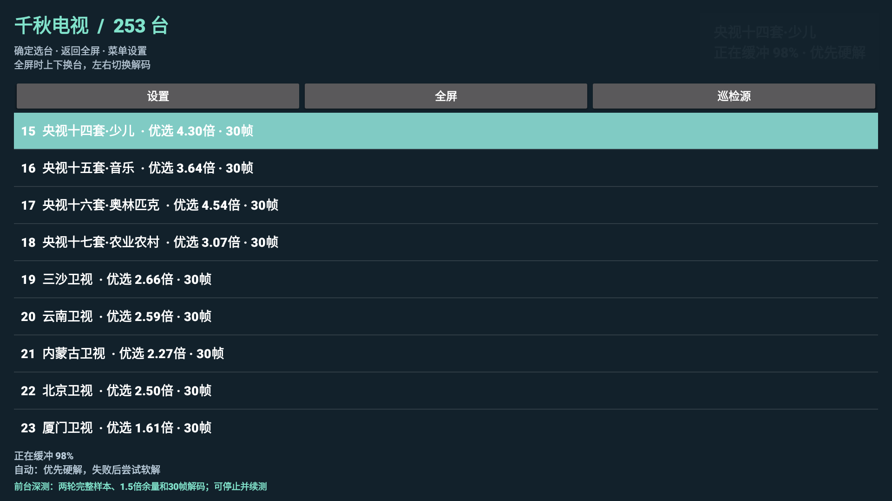

# 千秋直播

> **学习用途与免责声明：下载、安装或使用前请先阅读。**
>
> 本项目仅用于 Android 电视应用开发、遥控器适配、音视频解码及网络质量检测的学习和技术交流。不托管广播或影视视频；代码开源、地址公开、检测通过均不代表获得内容传播授权。请仅访问自己有权使用的内容，遵守适用法律、源站服务条款及第三方许可，不得用于侵犯版权或其他权益。
>
> 第三方列表、视频内容和网络条件随时变化，不保证频道身份、画面实时性、持续流畅、长期可用或全部设备兼容。本声明不免除依法应承担的责任。权利或安全问题请在本仓库 Issues 提供具体链接，以便核查处理。

当前版本 **1.3.2（versionCode 15）**，安装名称 **千秋电视**，包名 `com.tv.simplelive`，支持 Android 5.0 / API 21 及以上，包含 arm64-v8a、armeabi-v7a。使用 LibVLC 3.6.5；不设账号、会员或应用付费解锁。第三方内容的授权及可用性仍由各来源决定。

[下载 1.3.2 APK 与源码](https://github.com/suqianqiu/qianqiu-live/releases/tag/v1.3.2) · [安装指南](INSTALL.md) · [完整巡检与有效性规则](docs/SOURCE_RULES.md) · [本版验证记录](docs/VERIFICATION-1.3.0.md) · [第三方许可](THIRD_PARTY.txt)

## 1.3.2 更新

- **播放卡死后恢复**：监测播放时钟与已开始变化的解码帧计数，发现持续停滞或直播意外结束后，保留当前频道并自动重连。
- **有限重试**：按 1、3、6 秒退避，最多三次；持续正常播放 60 秒后重置预算。失败后显示提示，仍可切台和返回。
- **取消与播放器释放**：切台或退出会取消旧恢复任务；播放器停止在线程外处理，等待安全释放后再复用画面。自动解码策略后续可尝试软解，手动选择保持不变。
- 保留 1.3.1 华为设备直接 Surface 输出兼容修复。

微鲸 Android 5.0.2 完成策略 16 项、真实数据停滞恢复 10 项、遥控导航回归 35 项，共 61 项检查。AM9 Pro 与微鲸均已安装 1.3.2。华为未重复进行本次恢复测试；有限重连无法修复永久失效或内容错误的源。

**已知问题：CCTV5 曾被报告播放错误的保健品视频，本版尚未完成该问题的源隔离与修复，不能将“可连接/可解码”视为频道内容正确。**

详见 [1.3.2 验证记录](docs/VERIFICATION-1.3.2.md)。

## 1.3.0 的频道列表变化

- 保留原有 193 个频道的位置，修正同台异名，新增 60 个频道或特色直播条目；合并后 **253 个列表项、485 条候选线路**。景观直播、影视轮播单独分组，列表项数量不等同于传统电视台数量。
- 加入六个公开候选订阅，与原有五个订阅共同补充当前频道的线路。本轮电脑严格筛选得到 **97 个条目、118 条合格线路**，优先放入随包候选；旧频道没有新合格线路时保留原地址供尝试，不标为合格。
- 修正 CGTN“纪录/记录”重复，区分 CCTV5 / CCTV5+、CCTV4K / CCTV4，以及 CCTV4 欧洲版 / 美洲版。经过画面核对的 TVBS 新闻地址只按该 URL 更名，不把所有 TVBS 都合并为新闻台。
- 排除本轮确认的五条“NO SIGNAL”占位地址；这是一份已知地址排除表，并非能识别任意占位、广告或错误节目内容的通用识别器。
- 保留每频道 12 小时有效期、断点续测、前台检测、同台候选比选与失败提示。覆盖安装不自动启动应用。

本轮有合格的 CCTV1 和 CCTV5+；**CCTV5、CCTV6 没有通过本轮严格筛选**，仍保留频道位置供后续更新和手动尝试，不能声称已修复这两个频道的源站。

## 巡检怎样运行

每次进入前台是一个检查点，并非每次重新测全部频道。频道完整比选结束后，成功或失败记录均保存 12 小时；有效期内跳过。未完成的检测没有完成时间，下次继续已保存的分片和轮次。只在应用前台运行，离开前台暂停，不设后台检测服务或定时唤醒。

HLS 每条线路两轮、每轮四个不同的完整分片；计算每段“媒体秒数 ÷ 完整下载秒数”，最差值须 **≥1.5**，并通过至少 **30 帧实际视频解码**。不是仅测 HTTP 200、首字节、QPS 或少量 Range 数据。对当前纳入的同台候选（最多 12 条）都完成比较后，选最差速度余量最大的一个；相同则选最慢分片耗时更短的一个。

电脑样本不会伪装成盒子的巡检记录。电脑与盒子可能有不同的 DNS、线路和解码能力；盒子自行测量后才产生本机的 12 小时记录。网络变化或签名过期仍可能使已通过的源失效。自动巡检在选台播放时暂停，手动巡检可以继续播放并降为单路检测，仍可能占用网络带宽。

详细的边界、缓存、失败回退、支持格式和电脑/盒子差异见 [规则说明](docs/SOURCE_RULES.md)。

## 下载与遥控器

从 [Releases](https://github.com/suqianqiu/qianqiu-live/releases/latest) 下载 `QianqiuLive-1.3.2.apk`，使用 U 盘或已授权的网络 ADB 覆盖安装。升级应保留原签名；自行构建的签名与发布版不同，不能直接覆盖。源码 ZIP 不包含发行私钥。

| 按键 | 操作 |
| --- | --- |
| 确定 | 显示频道列表 / 选择播放 |
| 上、下 | 全屏播放时切换频道；失败时仍可继续切换 |
| 返回 | 返回列表 / 在未播放时退出 |
| 左、右 | 全屏时选择解码方式 |
| 菜单 | 导入列表、恢复随包列表、手动巡检、自动检查开关等设置 |
| HOME | 离开前台、停止播放并暂停巡检 |

失败时显示“该电视台无法播放，请继续点击↑或↓，或Back返回”，不自动跳回列表；播放组件调用异常会被捕获并显示提示，自动解码策略仅尝试一次软解。连续遥控事件有节流及异步播放器释放，减少事件堆积。

## 画面与验证

以下均为 **1.3.2 真实设备截图**：频道列表于 2026-11-09 从 AM9 Pro 重新采集；CCTV13 播放画面来自 2026-11-03 微鲸修复验证。仅代表截图时的界面和样本，不是全部频道或目前源可用性的保证。

## 构建

需要 JDK 21、Android SDK platform 35、build-tools 35.0.0、PowerShell 7。按 `tools/dependencies.json` 下载并核验官方 LibVLC 依赖，然后执行 `pwsh -File build.ps1`。构建脚本在本地生成测试签名，发行私钥不入库。指定自己有权操作的设备后才能用 `-Install -Device DEVICE_IP:PORT -AdbPort PORT` 安装；安装不自动启动应用。

本轮原始源站仅提供候选，不托管内容，不包含付费破解、DRM 绕过或鉴权规避功能。代码许可见 [LICENSE](LICENSE)，LibVLC 许可、源码及可替换构建说明见 [THIRD_PARTY.txt](THIRD_PARTY.txt)。
