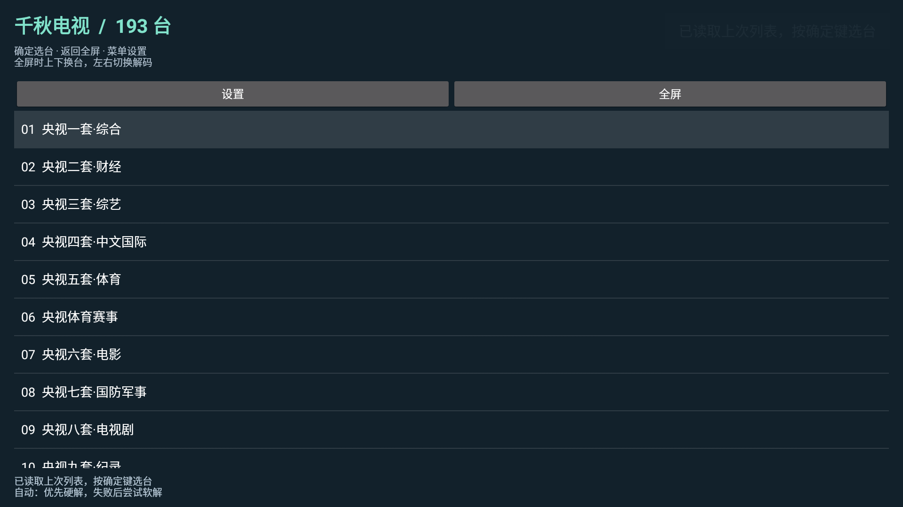
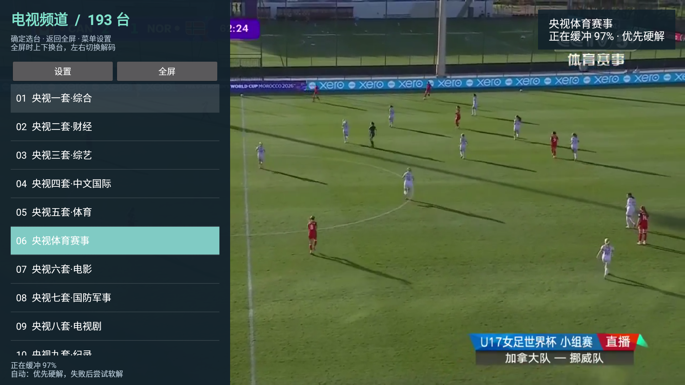

# 千秋直播

> **学习用途与免责声明：下载、安装或使用前请先阅读。**
>
> 本项目用于 Android 电视应用开发、网络播放、遥控器适配与音视频解码的学习和技术交流。本项目不托管影视或广播视频；代码开源、地址公开或检测通过，不代表已取得相关内容的传播授权。请仅访问自己有权使用的内容，遵守适用法律、来源服务条款及第三方许可，不得用于侵犯版权或其他权益的用途。
>
> 第三方网页、播放地址及评分数据可能变化；不保证全部内容可播放、长期可用或兼容所有电视。安装、网络调试和自行配置应由设备所有者了解后操作。本声明不免除任何依法应承担的责任。如发现权利或安全问题，请通过本仓库 Issues 提供具体链接和说明，以便核查处理。

面向遥控器和老 Android 电视的轻量直播播放器。当前发布 **1.0.6**，APK 安装后的名称沿用此前版本的 **“千秋电视”**，包名 `com.tv.simplelive`；本仓库和项目名称为“千秋直播”。

[下载 APK、播放列表和完整源码](https://github.com/suqianqiu/qianqiu-live/releases/latest) · [历史验证记录](VERIFICATION.txt) · [第三方说明](THIRD_PARTY.txt)

## 下载与安装

在 Releases 下载 `QianqiuLive-1.0.6.apk`，通过电视文件管理器安装。最低 **Android 5.0 / API 21**，安装包包含 **armeabi-v7a 和 arm64-v8a**。实测设备为微鲸 WTV55K1J，Android 5.0.2、2 GB 内存；其他型号尚未逐一验证。

Releases 同时提供经过筛选的 M3U / TXT 播放列表、完整源码 ZIP 和 `SHA256SUMS.txt`。普通安装只需下载 APK，列表已包含在 APK 中。

[直接下载 1.0.6 APK](https://github.com/suqianqiu/qianqiu-live/releases/download/v1.0.6/QianqiuLive-1.0.6.apk) · [M3U 列表](https://github.com/suqianqiu/qianqiu-live/releases/download/v1.0.6/channels-20261022.m3u) · [TXT 列表](https://github.com/suqianqiu/qianqiu-live/releases/download/v1.0.6/channels-20261022.txt) · [完整源码 ZIP](https://github.com/suqianqiu/qianqiu-live/releases/download/v1.0.6/QianqiuLive-1.0.6-source.zip)

## 电脑 AI 工具联网安装 / U 盘安装

**电脑 AI 安装：**在电脑上的 Codex、WorkBuddy 等具备本机终端与局域网访问能力的 AI 工具中，提供本项目地址、APK 下载链接和自己电视的 ADB 地址。工具可协助下载并校验 APK、通过同一局域网连接已授权的电视、执行覆盖安装并启动验证。电视端需先开启厂商支持的 ADB / 网络调试并确认授权；普通网页聊天不能直接替电脑安装。

**U 盘安装：**下载 `QianqiuLive-1.0.6.apk` → 复制到电视能识别的 U 盘 → 插入电视 → 在文件管理器中打开 APK → 按系统提示允许该安装来源 → 完成安装并从应用列表打开。U 盘只负责传输安装包，在线观看仍需要电视联网。

完整步骤、可复制给 AI 的提示词、ADB 命令、无线配对说明和常见问题见 **[安装指南 INSTALL.md](INSTALL.md)**。电视不支持 ADB 时可优先尝试 U 盘；两种方式都依赖电视系统允许安装外部应用。

## 功能

- 打开后直接进入全屏中文频道选择页，内置本轮筛选后的 **193 个频道**，选择后播放。
- 支持 HTTP / HTTPS M3U 和 `频道名,地址` 格式 TXT，可通过网络地址或本地文件导入。
- LibVLC 播放内核，提供自动、仅硬解、仅软解三种策略。自动模式遇到错误或 20 秒无视频时，只重试一次软解。
- 列表保存在电视本机；用户自行导入的其他列表不会被应用的随包列表升级覆盖。
- 界面使用通用电视矢量图标。离开前台时停止播放，避免持续占用电视解码器。

## 真实电视运行画面

以下截图取自此前真实电视调试。不同截图来自不同验证阶段，保留了当时的名称和界面；没有把旧画面包装成新的运行结果。

**此前版本的启动页：安装名称为“千秋电视”，显示 193 个中文频道。**



**实际直播成功画面：此前“央视频体育赛事”线路的足球比赛截图。频道菜单与视频画面同时可见；该截图证明当次线路已出画面，不代表所有 193 个频道长期稳定。**



## 遥控器操作

| 按键 | 操作 |
| --- | --- |
| 确定 | 显示频道列表；在列表中选择播放 |
| 上 / 下 | 全屏播放时换台 |
| 左 / 右 | 全屏播放时打开解码选择 |
| 菜单 | 设置、导入、直接播放和测试片 |
| 返回 | 列表 / 全屏切换；未播放时退出 |
| HOME | 离开前台并停止播放 |

## 播放列表检查

检查日期：**2026-10-22**。电脑端依次执行 HTTP 请求、ffprobe 媒体轨道探测和 FFmpeg 实际解码三帧；筛选过程不需要在电视上逐个播放。

| 指标 | 本轮结果 |
| --- | ---: |
| 候选地址 | 1,106 |
| 通过并纳入候选的线路 | 269 |
| 合并同台线路后的频道 | 193 |
| 大陆及原有中文频道 | 171 |
| 香港 | 8 |
| 台湾 | 14 |
| 澳门 | 0 |

澳门本轮测试的 27 条候选地址没有通过项，因此未强行加入失效频道。另排除了循环片和 Android 不兼容等 6 个可解码条目。详见 [检查摘要](validation-20261022/summary.json)、[报告](validation-20261022/report.txt) 和 [入选频道](validation-20261022/selected-channels.json)。

检查只代表当时可访问、可探测并能解码短视频帧，不保证频道身份、音频、长时间连续播放或每台电视的硬解兼容性。地址失效、地区限制或服务器拒绝访问时，切换软解也无法解决；老电视的软件解码性能也有限。

## 从源码构建

环境：Windows、PowerShell 7、JDK 21、Android SDK `platforms;android-35` 和 `build-tools;35.0.0`。SDK 默认在 `%LOCALAPPDATA%/Android/Sdk`，`javac`、`jar` 和 `keytool` 需加入 PATH。

```powershell
pwsh -File tools/fetch-deps.ps1
pwsh -File build.ps1
```

输出为 `dist/QianqiuTV-1.0.6.apk`，与发布 APK 的英文文件名不同，应用版本和包名一致。依赖下载脚本从 Maven Central 获取 LibVLC 3.6.5 并核对 SHA-256；Release 源码 ZIP 包含原始 AAR 和 Java 源码包。

签名私钥不公开。首次自行构建会生成自己的本地签名，不能覆盖不同签名的已安装版本。请使用自己的签名持续更新；卸载旧应用会清除其本地设置。

列表筛选工具为 `tools/validate_streams.py`，需要 Python 3、curl、ffprobe 和 ffmpeg：

```powershell
py -3 tools/validate_streams.py input.m3u --output validation --workers 8
```

## 来源与许可

应用源码使用 [MIT](LICENSE)，VideoLAN LibVLC 3.6.5 使用 LGPL-2.1-or-later，第三方协议和精确源码版本见 [THIRD_PARTY.txt](THIRD_PARTY.txt) 与 `licenses/`。公开播放列表来源包括 iptv-org、YueChan、fanmingming、Guovin 和 Free-TV，来源记录在 `validation-20261022/source-manifest*.json`。

本项目不托管广播视频，播放地址随源站变化。播放列表或应用代码的开源许可不代表第三方广播内容获得传播授权；请按来源许可及所在地区规定使用。
