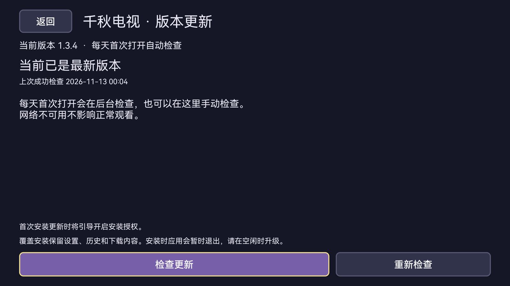

# 千秋电视：版本更新使用说明

从 1.3.4 起支持应用内升级。旧版本需要先通过 U 盘或已授权的 ADB 覆盖安装一次，之后就能直接在应用里升级。

## 每天首次打开检查

每天首次进入主界面时，应用会在后台优先检查腾讯云版本信息，腾讯云异常时检查 GitHub 最新正式版，按电视本地日期计算。同一天重新打开不会重复联网检查；发现新版后每天最多提示一次。「稍后」可关闭提示，不会自动下载或安装。检测失败不影响观看，当天可手动重试。没有后台定时唤醒，也不会在动画播放页弹升级提示。

## 用遥控器升级

1. 打开 **设置 → 版本更新**，查看当前版本、最近检查时间和新版本说明；需要时选择「重新检查」。
2. 发现新版后选择「下载更新」。下载中可暂停；离开升级页也会暂停，下次可继续下载，避免重复下载完整安装包。
3. 校验通过后选择「立即安装」。首次可能需要到电视设置中允许此应用安装更新；开启后返回升级页继续。
4. 在系统安装页面确认覆盖安装。安装期间应用会暂时退出，完成后重新打开。覆盖安装保留设置和现有数据，无需先卸载。

上图为本版在华为智慧屏的实际界面。不同电视的系统授权、安装确认页面可能不同。

## 失败时怎么办

- 检查失败：检查网络后手动重试。需要能够访问 GitHub，次日首次打开仍会再次检测。
- 下载中断：回到升级页选择「继续下载」。空间不足时先清理空间。
- 校验失败：应用会拒绝安装并清除错误安装包，请重新下载。只接受本应用包名、原签名和更高版本的安装包。
- 取消安装：可返回升级页重新安装。电视禁止第三方安装或没有授权入口时，可使用电视支持的 U 盘或 ADB 覆盖安装方式。
- 显示最新版本：当前没有需要升级的正式版本，预发布版本不参与自动升级。

升级检查与直播源巡检、动漫广告规则是不同功能。升级可以取得后续修复和规则更新，但不保证能去除烧录在视频画面中的广告。

## 1.3.5：腾讯云优先、GitHub备用

版本信息地址：`https://www.dajinsuan.com/tvapp/qianqiu-live/latest.json`。安装包固定放在对应版本目录。腾讯云下载重试后仍失败时，尝试GitHub附件API及原附件地址；同一版本的文件长度及SHA-256保持一致，最后仍验证包名、签名、版本及架构。次数有限，失败保留进度，可手动继续。应用内不包含云服务密钥。

旧版没有这个腾讯云地址，首次需要覆盖安装一次新客户端。不要为升级卸载或清数据。本地兼容测试起点显示1.3.4，但包含与正式1.3.5相同的升级逻辑与新Logo，用于手动升级验证；它不替换历史GitHub附件。

已在微鲸Android 5运行生产升级代码验证完整APK下载与安装包身份，并检查主备切换和断点续传。没有安装额外QA应用。系统安装步骤留给用户手动测试，未宣称所有电视均已验证。

## 1.3.6：透明圆角图标补丁

仅修复Logo外围透明通道，沿用1.3.5的升级机制。本地兼容测试起点无需再次覆盖，可手动重新检查并升级到1.3.6。

## 1.3.7：逐源质量更新与桌面退出

沿用前台触发、12小时到期缓存的巡检机制。每条线路测完就显示当前已测出的合格线路及“已测i/N”；仍在比选时的临时结果独立保存，不会被误认为所有候选都已完成。中断后保留已有质量，重进应用先恢复显示，再继续未完成线路。坏线路不会抹掉当前已经测到的合格线路，更新也不改变遥控器选中行与滚动位置。

全屏频道列表和左侧频道列表的底部都有“回到桌面”，遥控器在最后一行继续向下即可选中。点击后停止播放、重连与巡检，打开系统桌面并结束应用任务。播放器原生停止即使暂时等待，也在后台清理，桌面操作不等待它。

返回键：全屏播放→打开列表；列表→回到桌面。若只是想收起列表继续播放，选择顶部“全屏”。系统弹窗仍先关闭自身。

## 1.3.8：分类抽屉与返回键修正（当前方式）

1. 直播全屏按Back打开左侧抽屉，再按Back收起抽屉继续播放，重复按不会退出应用。未选台时保留列表；退出请使用顶部“回到桌面”。
2. 全屏列表和侧栏的“回到桌面”均在顶部。遥控器在首个分类按上可到达；桌面按钮按左连接设置/全屏/巡检工具栏，工具栏按下回到列表。
3. 抽屉按央视、卫视、各省市、港澳台、海外分类。确定展开或收起；右键展开并进入首个频道，左键收起并回到分类标题。其他分类保留无法可靠归属的频道，不会直接丢弃自定义频道。
4. 分类标题后的x/y按频道身份计数，不按候选URL数量。x是有效周期内已完整比选的频道数，y是该分类频道总数；检测失败也计入已测。逐条线路质量会即时更新，但未完成比选不会虚报频道完成。分类折叠时进度仍更新，重进应用恢复未过期的完整断点。

沿用前台自动触发、12小时有效期、播放时暂停自动深测和手动巡检机制，不增加后台定时任务。此节替代1.3.7的底部按钮和Back退出说明。

## 1.3.9：按钮焦点更醒目

主界面、版本更新页和应用内弹窗操作按钮采用统一高亮：焦点为亮青实心底、深色加粗文字和白色粗描边；未选中深色，按下提亮，禁用变灰。保持按钮尺寸与遥控器导航，不增加缩放、闪烁或页面滚动。系统自身的安装/权限界面仍使用电视系统样式。
