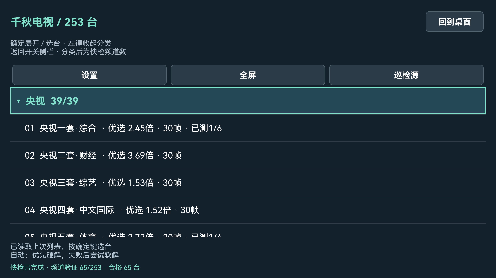

# 千秋电视1.3.10 验证

## 通过

- 正式ARM64/ARMv7 APK构建及v1/v2/v3签名验证，保持已发布的正式签名。SimpleLiveTV主源码合并后全部Java源编译通过。
- 新管线29项确定性HTTP夹具检查：慢远程订阅不阻塞快检或已有线路深测、16 KiB Range、快检不冒充优选、先覆盖其他频道再测备用、失败频道保留、失败缓存和到期恢复、取消/续测、HTML伪装拒绝、29帧不能合格、晚到候选快速显示并修复原线路。
- 原巡检引擎14项回归：逐路质量通知、坏候选不抹掉已测合格源、取消后保留质量、未完成不生成完成断点、恢复已有样本并检查剩余候选。
- Android11/API30隔离横屏模拟器，Activity视口1920×1080、density320：41项原生界面检查通过，包括快检即时更新分类覆盖数、快检不算深测完成、弱结果不覆盖有效优选、分层缓存恢复、旧回调隔离、焦点与视口保持、分类/频道索引、重复Back开关抽屉、顶部桌面按钮及原生stop等待时退出。
- 模拟器包与正式包的代码、清单和资源逐项摘要一致；模拟器包仅额外包含x86_64库。没有在物理电视安装QA APK。
- 华为HUAWEI ARIS-770D / API31 / 3840×2160：ADB覆盖安装1.3.10/code23，首次安装时间保持2026-10-31 23:17:01；已安装APK摘要与正式构建一致，未卸载或清数据。
- 华为保留现有列表及路由缓存：日志在开始后2367ms记录58/253（可达58），43355ms记录250/253（可达204）。随后界面观察到“快检已完成 · 频道验证 65/253 · 合格 65 台”；分类进度和频道质量分别显示。
- 增加单候选完成/合格计数、晚到新候选立即使失败决策失效、恢复已合格线路不被旧失败缓存覆盖的回归，避免统计提前或缓存降级。
- 实机日志观察到后台AVC解码输出30帧并产生新的合格结果；实际查看4K界面截图，分类计数、质量、底部阶段和按钮完整可读。

## 未验证与边界

- 上述华为耗时包含已有缓存，不是冷缓存基准；没有准确记录全部253项快检的完成毫秒数，不能把部分进度说成全部检测完成，也不能与旧版全量深测耗时计算倍数。
- HTTP夹具使用解码桩，仅验证流程与阈值约束，不代替实机视频质量测量。未等待华为全部候选深测/备用比选完成，未证明全部频道有效或没有广告。
- API36模拟器未作为本轮通过的验收环境，实际采用API30横屏模拟器和华为API31；未在本轮重复安装微鲸和AM9 Pro。
- 快检只检查HTTP与视频前缀，不能证明身份、无广告或持续流畅；优选条件未降低。自动深测只在前台未播放时运行。
- 本轮未修改升级下载模块，未重复进行完整OTA下载/系统升级流程验收。发布包签名、身份、已安装文件摘要及云端附件摘要会核对。
- 本次修改为原生Android界面和后台巡检，没有Web页面修改。

