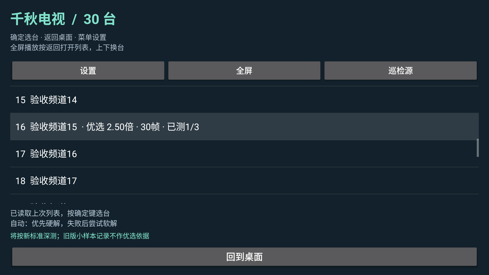
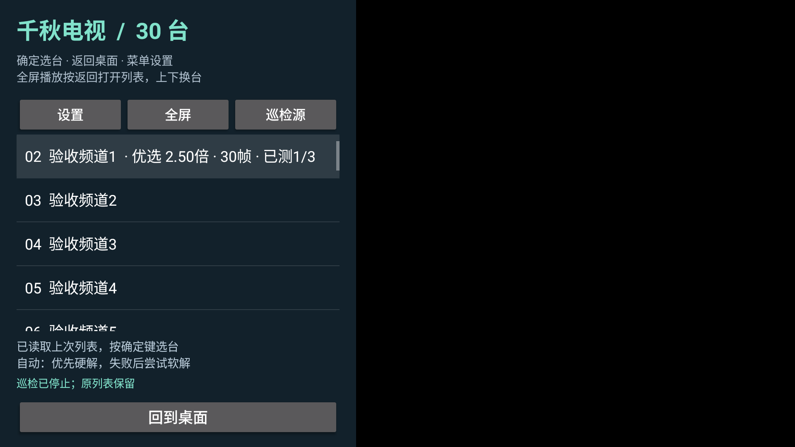

# 千秋电视1.3.7 验证

## 通过

- 正式APK构建及v1/v2/v3签名验证通过，保留正式发布签名；正式包包含arm64-v8a、armeabi-v7a。
- JVM确定性HTTP测试14项通过：首条线路早于整个频道完成通知；逐条失败通知；已测合格源保留；取消后仍保留质量；未完成比选不生成完成断点；恢复样本并继续剩余线路。
- Android TV API36模拟器23项通过：逐条显示、选中行与滚动位置保持、焦点保持、部分结果持久化及自动恢复、旧代次与不同列表回调隔离、全屏/侧栏桌面按钮、D-pad到达底部按钮、返回系统桌面、结束任务、原生stop等待时退出仍可完成、Back两步退出。
- 实际检查1920×1080两种列表截图；底部按钮可见且不遮挡列表，质量说明可读。
- 模拟器构建与正式APK代码、清单及资源逐项一致；模拟器构建仅额外包含x86_64原生库。原生界面验收没有修改Web页面。

- Android TV API36模拟器运行正式升级代码，完整取得正式ARM安装包并通过SHA-256、包名、签名、版本及CPU架构检查；下载通过电脑代理进行，不能算国内网络直连测试。

## 未验证与边界

- 当前电脑位于192.168.43.x网段，旧华为192.168.3.4及微鲸地址不可达，本轮没有覆盖或验收物理电视。
- HTTP单元测试使用解码桩，只验证事件与续测逻辑；不表示实际频道通过30帧、速度余量或广告身份检查。
- 截图使用测试频道，侧栏右侧未播放真实节目。

