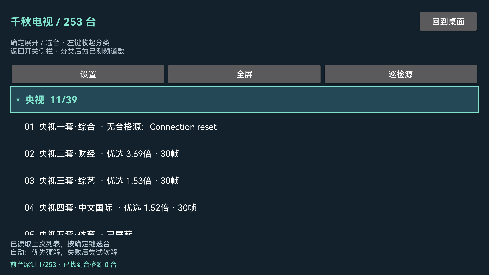
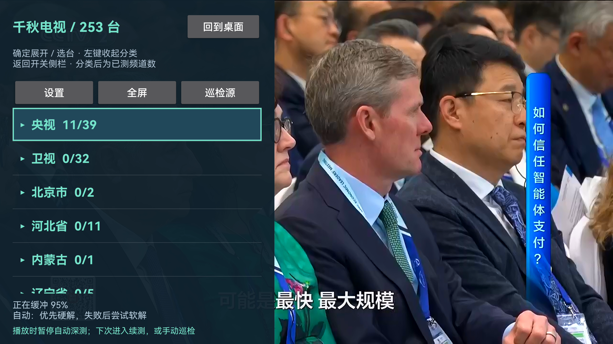

# 千秋电视1.3.8 验证

## 通过

- 正式ARM64/ARMv7 APK构建及v1/v2/v3签名验证；保留已发布的正式签名。
- 分类模型277项断言：全国/卫视/省市/港澳台/海外及未知分组、重名多线路计数、抽屉行与原始频道索引；逐一检查随包253个频道都恰好归属一个分类，没有被分类操作删除。
- 原巡检引擎14项HTTP夹具回归通过，包括逐源通知、坏线路不覆盖已测好源、取消保留与断点续测。
- Android TV API36隔离模拟器运行正式ARM包，38项原生交互检查通过：分类完成与部分结果分离、失败计数、重复回调去重、不同分类独立进度、过期代次/不同列表隔离、断点恢复、焦点与视口保持、左右/确定展开收起、工具栏到达、分类行到原播放索引映射、三轮Back开关不退出、onBackPressed兼容入口、两种列表顶部按钮、任务退出与异步原生stop。
- 华为HUAWEI ARIS-770D / API31 / 3840×2160：ADB覆盖安装1.3.8/code21，首次安装时间保持2026-10-31 23:17:01；未卸载或清除用户数据。未安装QA应用。
- 华为实机播放央视二套时：首个Back打开侧栏、第二个Back收起且应用进程保留、第三个Back再次打开；点击顶部“回到桌面”后恢复系统com.huawei.homevision.launcher/.HomeActivity。
- 查看全屏列表和直播侧栏的实际4K截图：顶部按钮可见，分类进度与频道质量可读，焦点使用深色底与青色描边，列表区域独立滚动，底部状态保留。

- Android TV模拟器执行正式升级代码：本轮腾讯云下载的32,555,364字节有效前缀恢复续传，补齐正式APK后通过SHA-256、包名、版本、签名和CPU架构校验。测试连接使用电脑代理，不等同于电视国内网络直接升级安装验收。

## 边界与未验证

- 本轮没有在微鲸或AM9 Pro重复安装与交互验收。
- HTTP夹具使用解码桩，只验证事件和续测，不表示真实源符合30帧或速度余量，也不表示全部频道身份、广告或长期流畅已经核验。
- 省市依据分组元数据、频道名和随包已知地方台前缀；未知自定义频道进入“其他”，不猜测或删除。进度针对当前列表中的频道，不等于后台所有待发现的候选URL数量。
- 本次为原生Android界面，没有Web页面修改。

