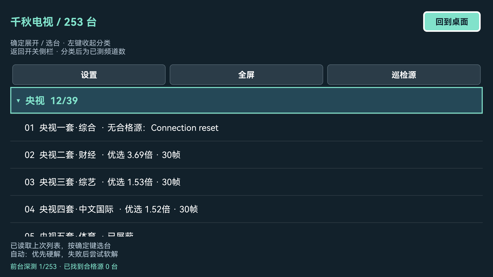
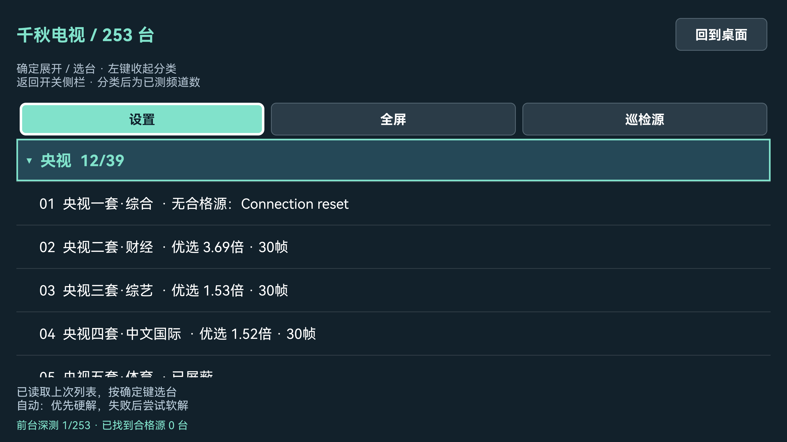
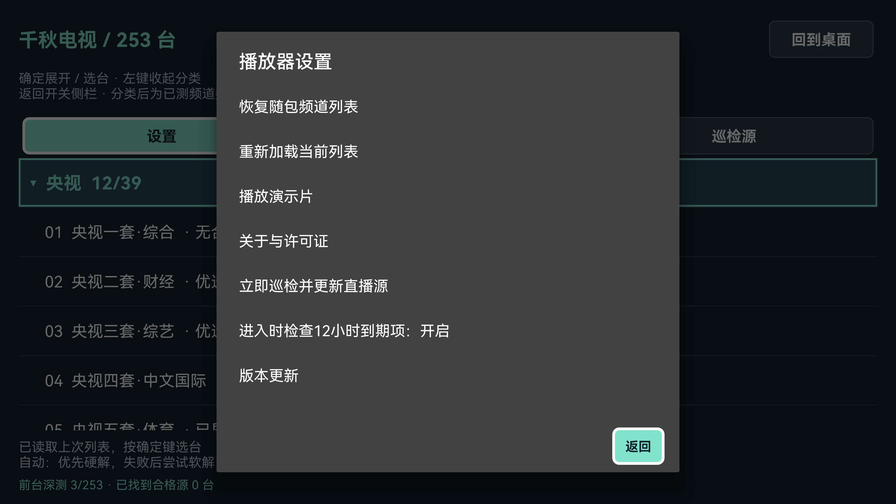

# 千秋电视1.3.9 验证

## 通过

- 正式ARM64/ARMv7 APK构建及v1/v2/v3签名验证通过；与前版正式签名一致。主源码SimpleLiveTV合并后所有Java源编译通过。
- 华为HUAWEI ARIS-770D / API31 / 3840×2160：ADB覆盖安装1.3.9/code22；首次安装时间保持2026-10-31 23:17:01，未卸载或清数据，未安装QA APK。
- 已安装APK的SHA-256与正式构建和腾讯云待发布包一致。
- 逐个使用遥控方向键选中回到桌面、巡检源、全屏、设置，UI层级确认每次只有对应按钮获得焦点；实际截图检查亮青色填充、深色文字、白色粗描边，其他按钮为深色。
- 确定键打开设置；下移到弹窗返回按钮，焦点同样高亮。弹窗保持原尺寸，按钮位于屏幕内。
- 通过设置打开版本更新页，检查更新按钮获得焦点，实际截图确认高亮且页面按钮完整可见。
- 本轮为原生Android状态样式修改，无Web页面修改；不增加缩放动画，不改变按钮外部布局尺寸。

## 未验证与范围

- 未在本轮重复进行微鲸/AM9 Pro实机验收；仅在华为API31实际运行。
- 按下和禁用样式已实现，本轮没有单独抓取按住按钮或升级忙碌瞬间的状态截图；未实际触发系统升级安装权限弹窗。
- 未重跑1.3.8的全部巡检/播放/升级下载测试。本轮未改动AppUpdate、巡检引擎、分类模型或播放逻辑，按受影响按钮和操作验收，不将前版测试计作本轮结果。

